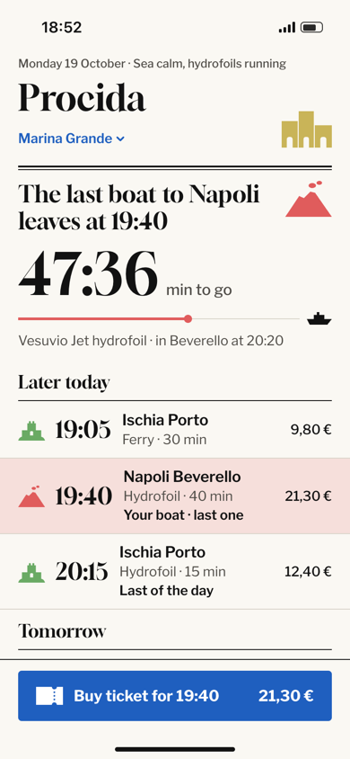
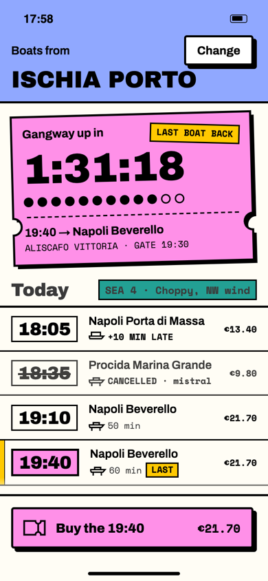
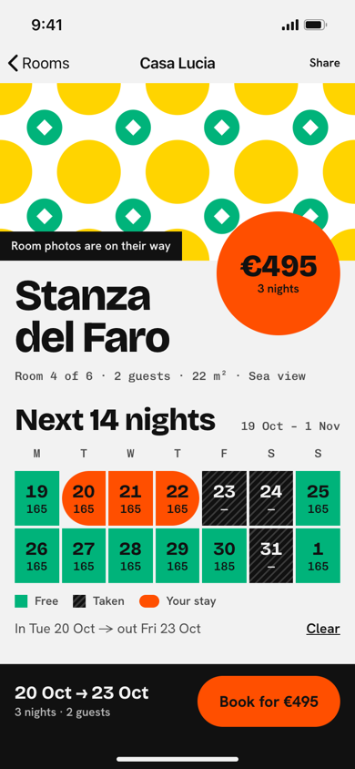
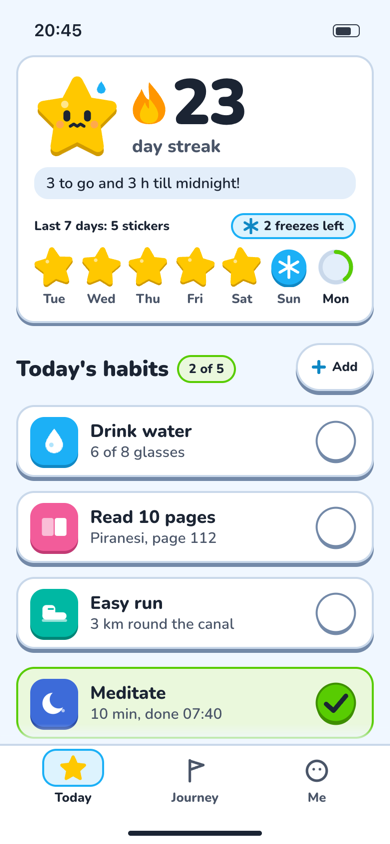
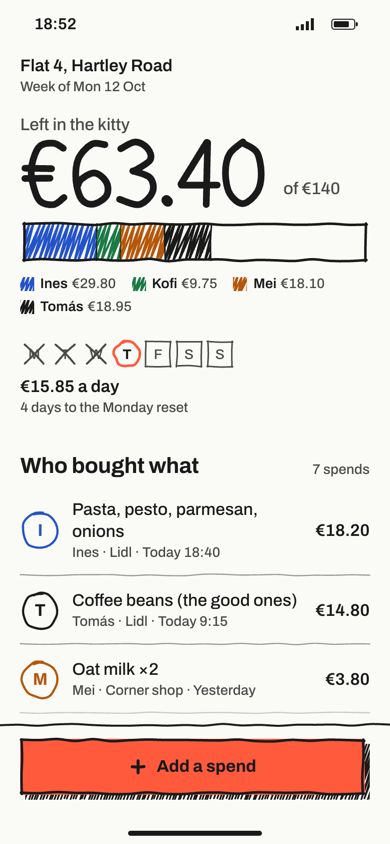
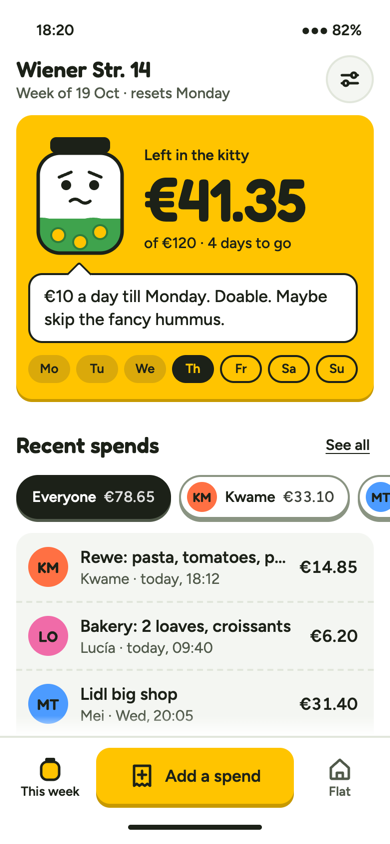
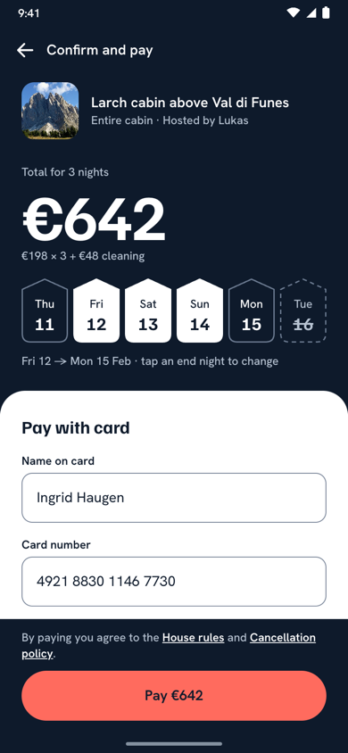
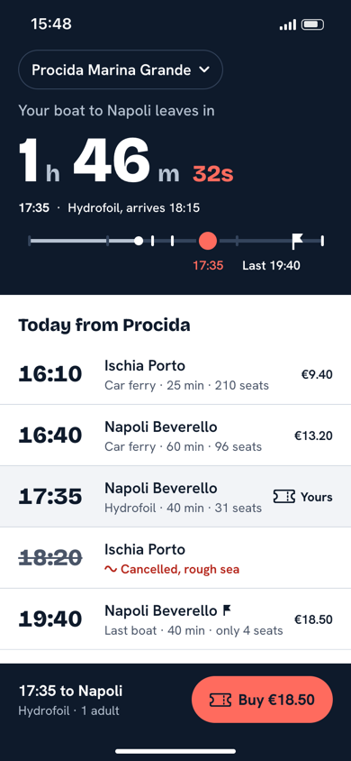
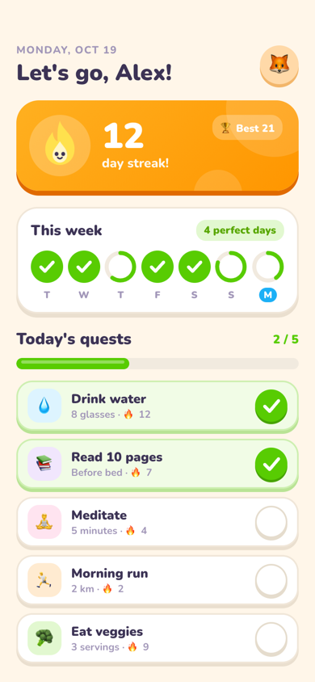
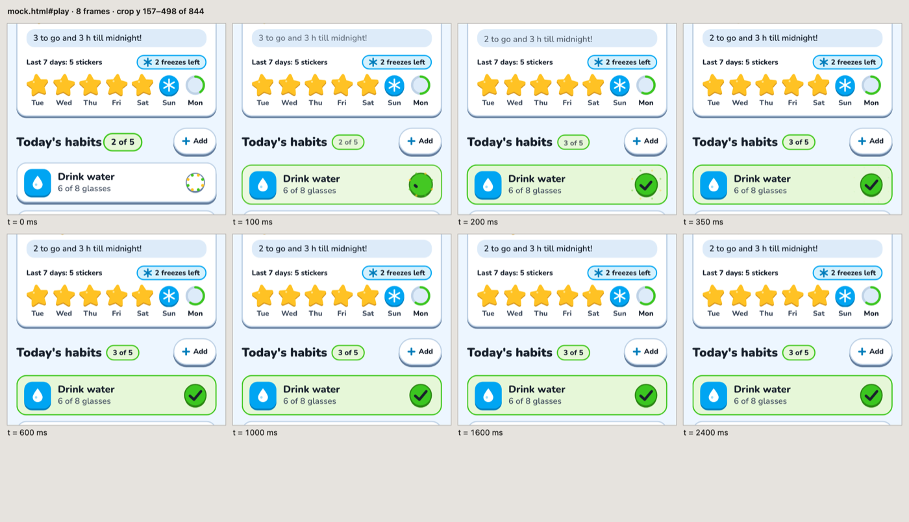

# app-ui-slopless

**An Agent Skill that makes coding agents design app screens with an idea of their own, instead of the average AI app.** For iOS and macOS (SwiftUI) and Android (Jetpack Compose / Compose Multiplatform), grounded in studied UX principles rather than vibes.

<p>
  <a href="LICENSE"></a>
  
  
  
  <a href="evals/README.md"></a>
</p>

It avoids two failure modes equally:
- **Slop:** the default AI look. Grey cards with soft shadows, purple gradients, Inter everywhere, emoji for icons.
- **Pretty but broken:** a bold style on a flow that's hard to use, with clipped numbers or rows cut off behind the tab bar.

Screens it built, each from one brief, in our blind evals:

<table>
  <tr>
    <td width="25%"></td>
    <td width="25%"></td>
    <td width="25%"></td>
    <td width="25%"></td>
  </tr>
  <tr>
    <td><sub><b>Ferry home</b>, SwiftUI<br><code>ed-newspaper-frame</code>: each island owns a colour and a glyph</sub></td>
    <td><sub><b>Ferry home</b>, SwiftUI<br><code>nb-sticker-sheet</code>: the paper ticket becomes the sticker</sub></td>
    <td><sub><b>Guesthouse room</b>, no photos<br><code>ed-monogram-grid</code>: the majolica floor tile holds the data</sub></td>
    <td><sub><b>Habit tracker</b>, Compose MP<br><code>pl-toy-box</code>: a fridge-chart star, and a mascot that worries</sub></td>
  </tr>
  <tr>
    <td></td>
    <td></td>
    <td></td>
    <td></td>
  </tr>
  <tr>
    <td><sub><b>Flat grocery budget</b>, CMP<br><code>nb-hand-drawn</code>: the fridge whiteboard</sub></td>
    <td><sub><b>Flat grocery budget</b>, CMP<br><code>pl-persona</code>: a coin jar with a mood</sub></td>
    <td><sub><b>Checkout redesign</b> after a UX audit<br><code>wp-exaggerated-number</code></sub></td>
    <td><sub><b>Ferry home</b>, SwiftUI<br><code>wp-exaggerated-number</code>: time left on the island</sub></td>
  </tr>
</table>

<sub>macOS support (v1.5) has a compile-and-lint gate, a reference, rules `R-MAC-1…9` and an eval, but the blind-eval results below are iPhone and Android only.</sub>

<sub>The screens are the HTML mocks each run writes next to its SwiftUI or Compose code, rendered at 390×844. Names, prices and timetables are sample content.</sub>

<p><a href="#install">Install</a> · <a href="#same-brief-with-and-without">With vs without</a> · <a href="#how-it-works">How it works</a> · <a href="#what-it-checks-before-handing-over">What it checks</a> · <a href="#evals">Evals</a> · <a href="#layout">Layout</a></p>

## Install

As a Claude Code plugin (updates with `/plugin update`). Run these inside Claude Code:

```
/plugin marketplace add massipetro/app-ui-slopless
/plugin install app-ui-slopless@app-ui-slopless
```

As a plain skill:

```bash
git clone https://github.com/massipetro/app-ui-slopless ~/.claude/skills/app-ui-slopless
```

For any other agent that supports the Agent Skills format, copy the folder into its skills directory. The scripts need Python 3.9+ and nothing else. The compile and render checks use Xcode, a JDK and a Chromium browser when they're there, and say so in the report when they're not.

Then just ask:

| Mode | Example request |
|---|---|
| **Build** | "Build the home screen of my habit app, playful style" |
| **Redesign** | "My profile screen is boring, redesign it neo-brutalist" |
| **Audit** | "UX audit of this checkout screen, then redesign it" |
| **Spec** | "Give me a design system / tokens for this app" |

## Same brief, with and without

The same prompt ("a habit tracker home in Compose Multiplatform, Duolingo-level fun") given to the same model, judged blind:

<table>
  <tr>
    <td width="50%" align="center"></td>
    <td width="50%" align="center"></td>
  </tr>
  <tr>
    <td align="center"><b>With the skill: 7.0</b><br><sub>"a product idea of its own": the star worries as midnight nears</sub></td>
    <td align="center"><b>Without: 6.0</b><br><sub>"Duolingo's home screen re-skinned"</sub></td>
  </tr>
</table>

## How it works

1. **Intake and inventory.** For a redesign, read the app's current look first (fonts, colours, mascot, illustrations) and keep its identity assets by default. Then list 8–12 things only this product has: its objects, rituals, places and numbers.
2. **Deal, don't default.** `scripts/deal.py` deals three researched directions that can show the screen's content (20 directions, each anchored in shipped apps). Each one goes through a fit test (including a product-category fit table), and misfits are dropped. The skill recommends one and asks up to four questions (direction, what to keep, how far to go, what to focus on), with its recommendation first. Asked to choose a look, a model picks the category default every time, so the deal takes that choice away from it.
3. **Owned idea.** One sentence: *"In this app, ⟨inventory item⟩ becomes ⟨device⟩."* It has to fail for the nearest competitor. One live interaction reacts to real state.
4. **Build.** Tokens, then components, then the screen, with real content at real density, following a code baseline: stable identity, state that survives, transforms not layout.
5. **Check, fix, report.** The gates below. Then a scored critique of the screenshots, at most two fix rounds, and a fixed report block.

<details>
<summary>What a deal looks like</summary>

```text
$ python3 scripts/deal.py --options 2 --content list,number --preset playful
- pl-toy-box  (playful) Toy box  [B8 M8 D3 C8 F7]
    anchors: Duolingo (ADA 2023, shape language, lip buttons)
    composition: Rhythm, not a grid: one big hero card (streak or progress), a pair of
    medium tiles, then small chips. Every pressable sits on a darker lip. A mascot in
    the hero reacts to real state.
    holds: list, number, action
    idea slot: In this app, <inventory item> becomes the toy piece the core verb is pressed on.
- pl-persona  (playful) Persona over data  [B6 M6 D5 C6 F6]
    anchors: CARROT Weather (personality levels); Gentler Streak (ADA 2024, Yorhart)
    ...
```

`--direction <id> --seed <n>` then prints the full sheet: two type systems, two palettes with measured contrast in light and dark, shape, signature moves, motion and how the direction goes wrong.
</details>

### Styles: four presets, five dials

| Preset | Feel | Real-world anchors |
|---|---|---|
| Warm premium | photo-led, confident type, one owned accent | Airbnb, Uber, Monzo, Flighty |
| Neo-brutalist | thick strokes, hard offset shadows, flat clashing colour | Gumroad, Figma, Nothing, Teenage Engineering |
| Playful / toy | chunky lipped pieces, custom glyphs, a mascot, springy motion | Duolingo, (Not Boring) Habits, Headspace |
| Editorial | huge display type, magazine grids, stark contrast | Spotify Mix/Wrapped, NYT Games, Nike SNKRS |

Dials from 1 to 10: `BOLDNESS`, `MOTION`, `DENSITY`, `COLOR` and `FIDELITY` (how bespoke the components look; platform mechanics stay native). Name a preset or let the deal pick one.

## What it checks before handing over

| Check | How | Catches |
|---|---|---|
| Compiles | `scripts/typecheck.py` (Swift, iOS simulator or macOS SDK, at the project's deployment target; iOS 17 / macOS 14 by default) · Gradle or `scripts/compile_kotlin.py` (Kotlin 2.2 + Compose MP 1.9) | code that only looks right |
| Lint | `scripts/lint.py` | slop tells (violet accents, stock greys, 5%-black shadows, emoji), sub-44/48 targets, fixed font sizes, code-baseline mistakes; in macOS mode also missing hover states, menu commands and window sizes, and phone-sized frames |
| Bottom edge | `scripts/fold.py` measures the mock at 390×844 | a row or a sliver of card cut by the tab bar at rest; a last row that can't scroll clear |
| Signature | the resting frame, against the category's stock layout | a good direction built as the default layout in new paint |
| Motion | `scripts/filmstrip.py` freezes every animation at set times | a check-off that never lands, counters that change too early, anything clipped mid-animation |
| Mascot | `scripts/mascot.py`: SVG rig to SwiftUI / Compose code and Lottie | freehand characters that differ per platform; a silhouette that doesn't read at 24 px |
| Taste | a scored critique of the screenshots (`references/critique.md`, 14 passes) | no focal point, sameness, a wireframe feel, an idea that only reaches the home screen |

Accessibility trade-offs are reported as warnings with the criterion, the value and a fix. Bold choices aren't silently blocked.

<details>
<summary>Motion, as the critique sees it</summary>



A screenshot can't show motion, so the skill films it. Every animation in the mock is paused at 0, 100, 200 ms and so on, and the frames are tiled into one image the critique can read. The script also prints how many animations run, the longest one, and how many loop.
</details>

<details>
<summary>What a run hands back</summary>

Every run ends with the same labelled block, so it can be read and checked at a glance (abridged from a real run):

```text
app-ui-slopless report
Direction: pl-toy-box (seed 52731); redeals: none (pl-one-ritual and pl-illustration-led dropped: can't show the habit list + week at rest)
Owned idea: In this app, the fridge chart's gold-star sticker becomes the toy piece each finished day is pressed onto the week with, and the mascot Pip is that star.
Competitor test: Streaks → its days are rings and tiles, with no sticker chart and no star character
Live thing: Pip's mood follows remaining habits and hours to midnight; filmstrip: 25 animations, longest finite 420 ms, 5 looping; settled by 320 ms, nothing clips
Lint: compile pass (Kotlin 2.2.21 / CMP 1.9.0, JVM + Android); lint 0 FAIL, 1 WARN kept: gradient-fill = the scroll fade above the tab bar
Critique (final round): Idea 8 · Hierarchy 7 · Craft 8 · Substance 8 · Platform 7 → overall 7.6 (caps: none)
Warnings: white habit icons on hue tiles ≈2.4:1 (1.4.11): decorative, the row name carries the meaning; fix = use a hue's lip colour for the icon
Not verified: Compose render (the HTML mock stands in); iOS compile; large-text reflow; haptics on device
```
</details>

## Evals

Six build briefs. Each was run with and without the skill and judged blind from screenshots by a separate model with `references/critique.md`. `evals/grade.py` adds objective checks: compile, lint, bottom edge, report block. Method, per-run scores and limits: [`evals/README.md`](evals/README.md). Live results page with every screen: [build eval](https://claude.ai/artifact/4xRqy6RHwvGgAsJoKck6QY).

| Round | Setup | Briefs | Blind wins for the skill | Average margin |
|---|---|---|---|---|
| 9 | Opus 5.5, every gate in place (mascot kit, fold, signature, iOS 17) | habit home, ferry × 2 runs | 4 of 4 | +0.55 |
| 8 | Opus 5.5 builds and judge, judges see motion filmstrips | habit home × 2 runs | 2 of 2 | +0.5 |
| 7 | Opus 5.5, balanced A/B, both compile gates | ferry, flat budget × 3 runs | 5 of 6 | +0.9 |
| 6 | Opus 5.5, balanced A/B | ferry, flat budget × 3 runs | 5 of 6 | +1.0 |
| 5 | Opus 5.5 | ferry, flat budget × 3 runs | 4 of 6 | +0.4 |
| 4 | Opus 5.5 | all six | 4 of 6 | +0.6 |
| 3 | Opus 5.5, Sonnet judge | all six | 6 of 6 (one tie on score) | +1.4 |
| 2 | Opus 5.5, Sonnet judge | ferry, flat budget | 2 of 2 | +0.5 |
| 1 | Sonnet 5 | ferry, flat budget | 2 of 2 | +1.5 |

34 of 40 pairs went to the skill. Each round fixed what the one before found:
- the deal and fit test, after a direction that missed the product;
- the compile gates, after code that didn't build;
- the fold check, after rows cut by the tab bar;
- the filmstrip, because motion was invisible to the judges;
- a stricter fold rule, after round 9's judges capped a 2 px sliver and a half-showing row that the first version passed.

The skill runs cost about 1.6–1.9× the baseline. One run per config and one model judge per pair: treat each score as ±0.5.

## Grounded in

Norman, Nielsen, Shneiderman, Fitts, Hick–Hyman, Cowan, Hoober, Clark, Budiu/NN/g, Cooper, Wroblewski, Bringhurst, Lupton, Albers, Tufte, Chang & Ungar, Willenskomer, Saffer, Walter, Kurosu & Kashimura, Tractinsky, Lindgaard, Tuch, Hassenzahl, Apple HIG, Material 3, and WCAG 2.2. See [`research/literature.md`](research/literature.md); every claim is tagged by how well it's verified. The visual references are real shipped apps (Apple Design Award winners, design-team case studies), not AI concept shots: [`research/real-ui-references.md`](research/real-ui-references.md).

**Companion skills** for deeper code correctness (optional): [twostraws/swiftui-agent-skill](https://github.com/twostraws/swiftui-agent-skill) for SwiftUI, and [aldefy/compose-skill](https://github.com/aldefy/compose-skill) for Compose/CMP. See [`research/code-baseline.md`](research/code-baseline.md).

## Layout

<details>
<summary>Files</summary>

```
SKILL.md                    workflow, core rules, motion budget, slop tells, checklist
references/
  principles.md             rule IDs (R-TOUCH-2 …) with sources, for audits
  audit.md                  audit process + report template
  platform-swiftui.md       SwiftUI patterns + code baseline
  platform-compose.md       Compose / CMP patterns + code baseline
  platform-macos.md         macOS patterns: windows, sidebar, toolbar, pointer, keyboard, density, vibrancy
  presets/*.md              one file per style
  critique.md               the scored taste pass on screenshots
  mascot.md                 designing a mascot or hero glyph the skill can draw, rig it, ship it, animate it
library/directions.json     20 dealt directions (5 per preset), with palettes checked for contrast
scripts/deal.py             deals directions; --check validates the library (Python 3.9+, stdlib only)
scripts/lint.py             FAIL/WARN gate for slop tells, craft defects and code-baseline patterns in .swift / .kt
scripts/typecheck.py        typechecks SwiftUI files against the iOS simulator or macOS SDK, no Xcode project needed
scripts/compile_kotlin.py   compiles Compose / CMP files in a throwaway Kotlin 2.2.21 + Compose MP 1.9.0 project (JVM + Android)
scripts/kotlin-check/       the Gradle template that compile_kotlin.py copies code into
scripts/fold.py             measures the mock's bottom edge: every row at the pinned bar is whole or cut, and the last row clears it
scripts/filmstrip.py        turns motion into one readable image: frames of an HTML mock paused at set times, with measured durations
scripts/mascot.py           mascot kit: SVG rig to SwiftUI / Compose code, to Lottie JSON, a pausable preview, and the 24 px check sheet
research/                   the source material behind the rules
evals/                      briefs, input files, grade.py, and model-free tests for fold.py and the mascot kit
docs/examples/              the screens shown above
```
</details>

## Licence

MIT. See [LICENSE](LICENSE).
